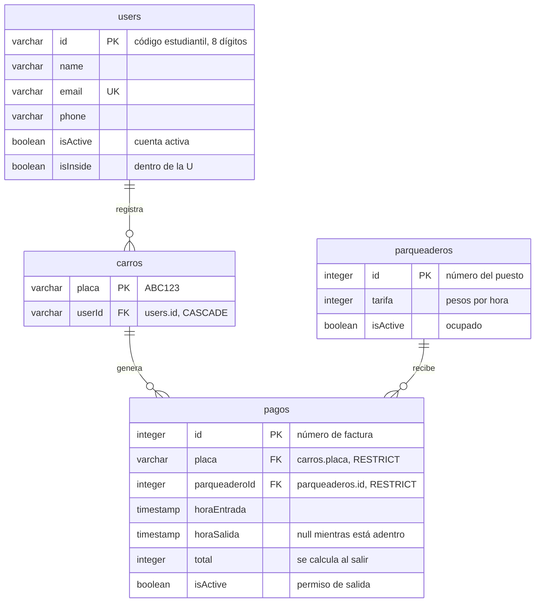

# Jave Parking — Backend

API del parqueadero de la **Pontificia Universidad Javeriana Cali**. Sirve para ahorrar filas al entrar y al pagar: el estudiante registra su carro, ve qué puestos están libres antes de llegar y, al salir, la app calcula cuánto debe pagar según los minutos que estuvo parqueado.

Proyecto del curso **Plataformas Computacionales** (2026-2), construido sobre el seed NestJS del curso.

**Integrantes:**
- Mateo Rivera Prados 
- Diego Alejandro Calvo 
- Jan Pieter Lelie
- Carlos Sánchez

## Qué hace la API

| Módulo | Para qué sirve |
|---|---|
| **Users** | Estudiantes registrados con su código estudiantil. |
| **Carros** | Placas que registra cada estudiante (formato `ABC123`). |
| **Parqueaderos** | Puestos del parqueadero, con su tarifa por hora y si están ocupados. |
| **Pagos** | Facturas: entrada de un carro a un puesto, salida y cobro por minuto. |

## Tecnologías

- **NestJS 11** + TypeScript
- **TypeORM** con **SQLite** (por defecto) o **Postgres**
- **class-validator** / **class-transformer** para validar los datos
- **Postman** para probar
- **AWS EC2** (Amazon Linux 2023) + **PM2** para el despliegue

## Modelo de datos



- **`pagos` es la tabla intermedia** entre carros y parqueaderos: un carro usa muchos puestos y un puesto recibe muchos carros. No es un `@ManyToMany` directo porque cada visita guarda sus propios datos (horas y total).
- **CASCADE:** si se borra un usuario, se borran sus carros. En la práctica no pasa, porque los usuarios se desactivan (soft delete).
- **RESTRICT:** no se puede borrar un carro o un puesto que tenga facturas, para no perder el historial.
- **`isActive` significa algo distinto en cada tabla:** cuenta activa en `users`, ocupado en `parqueaderos` y permiso de salida en `pagos`.

## Endpoints

### Users — `/users`

| Método | Ruta | Qué hace |
|---|---|---|
| `POST` | `/users` | Registrar un estudiante. Body: `{ id, name, email, phone }` |
| `GET` | `/users` | Listar los usuarios con cuenta activa |
| `GET` | `/users/:id` | Buscar por código estudiantil |
| `PUT` | `/users/:id` | Cambiar `name`, `email`, `phone` o `isInside` |
| `DELETE` | `/users/:id` | Desactivar la cuenta (soft delete) |

### Carros — `/carros`

| Método | Ruta | Qué hace |
|---|---|---|
| `POST` | `/carros` | Registrar un carro. Body: `{ placa, userId }` |
| `GET` | `/carros` | Listar todos |
| `GET` | `/carros?userId=12345678` | Carros de un estudiante |
| `GET` | `/carros/:placa` | Buscar por placa (acepta minúsculas) |
| `DELETE` | `/carros/:placa` | Eliminar (solo si no tiene facturas) |

### Parqueaderos — `/parqueaderos`

| Método | Ruta | Qué hace |
|---|---|---|
| `POST` | `/parqueaderos` | Crear un puesto. Body: `{ id, tarifa }`. Empieza libre |
| `GET` | `/parqueaderos` | Listar todos los puestos |
| `GET` | `/parqueaderos?ocupado=false` | Solo los libres (`true` para los ocupados) |
| `GET` | `/parqueaderos/:id` | Buscar un puesto |
| `PUT` | `/parqueaderos/:id` | Cambiar la tarifa |
| `DELETE` | `/parqueaderos/:id` | Eliminar (solo si no tiene facturas) |

### Pagos — `/pagos`

| Método | Ruta | Qué hace |
|---|---|---|
| `POST` | `/pagos` | Registrar la **entrada**. Body: `{ placa, parqueaderoId }` |
| `GET` | `/pagos` | Listar facturas (las más recientes primero) |
| `GET` | `/pagos?placa=ABC123` | Facturas de un carro |
| `GET` | `/pagos/:id` | Buscar una factura |
| `PUT` | `/pagos/:id/salida` | Registrar la **salida**: cobra y libera el puesto. Sin body |
| `DELETE` | `/pagos/:id` | Eliminar una factura (solo si ya tiene salida) |

## Cómo funcionan la entrada y la salida

**Entrada** (`POST /pagos`), en `src/pagos/services/pagos.service.ts` → `create()`:
1. Revisa que el carro exista y que su dueño tenga la cuenta activa.
2. Revisa que el carro no esté ya adentro (no tenga una factura sin salida).
3. Revisa que el puesto exista y esté libre.
4. En una **transacción**: crea la factura, marca el puesto como ocupado y marca al dueño como dentro de la U.

**Salida** (`PUT /pagos/:id/salida`) → `registrarSalida()`:
1. Revisa que la factura exista y no tenga salida.
2. Calcula el cobro.
3. En una **transacción**: cierra la factura (hora de salida, total y permiso de salida), libera el puesto y marca al dueño como fuera (si no tiene otro carro adentro).

La transacción hace que los cambios se guarden **todos o ninguno**: si algo falla a la mitad, no queda una factura abierta con el puesto libre ni al revés.

**El cobro es por minuto:**

```
minutos = minutos que estuvo adentro, redondeados hacia arriba (mínimo 1)
total   = minutos × tarifa por hora ÷ 60   (redondeado a pesos)
```

Ejemplo: 3 min 43 s se cobran como 4 min. Con tarifa de $3.500 por hora: 4 × 3.500 ÷ 60 = **$233**.

Las horas se guardan en UTC y se muestran en hora de Colombia (`-05:00`).

## Códigos de respuesta

| Código | Significa | Ejemplo |
|---|---|---|
| `200` / `201` | OK / creado | Listar, registrar |
| `400` | Datos con mal formato | Código de 5 dígitos, placa `AB1234` |
| `404` | No existe | Carro con un dueño que no existe |
| `409` | Conflicto | Placa repetida, puesto ocupado, carro que ya está adentro |

## Instalación y uso local

Requisitos: Node 20 o superior, npm y Git.

```bash
git clone https://github.com/mateorivera2410/Jave-Parking.git
cd Jave-Parking
npm install
cp .env.example .env
npm run start:dev
```

La API queda en `http://localhost:3000`. Abrir `localhost:3000` sin ruta muestra `Cannot GET /`, y es normal: prueba con `http://localhost:3000/users`.

### Variables de entorno (`.env`)

| Variable | Valor por defecto | Para qué |
|---|---|---|
| `PORT` | `3000` | Puerto de la API |
| `DB_TYPE` | `sqlite` | `sqlite` o `postgres` |
| `DB_DATABASE` | `data/app.sqlite` | Archivo de la base (o nombre de la base en Postgres) |
| `DB_SYNCHRONIZE` | `true` | Crear y ajustar las tablas automáticamente |
| `DB_LOGGING` | `false` | Mostrar el SQL en la terminal |

Si usas Postgres también hacen falta `DB_HOST`, `DB_PORT`, `DB_USERNAME` y `DB_PASSWORD`. El `.env` no se sube a GitHub.

### Comandos

| Comando | Para qué |
|---|---|
| `npm run start:dev` | Arrancar en desarrollo (se recarga al guardar) |
| `npm run build` | Compilar a `dist/` |
| `npm run start:prod` | Arrancar la versión compilada |
| `npm run lint` | Revisar el código |
| `npm run lint:fix` | Corregir el formato automáticamente |

## Cómo probar

La colección de Postman está en `postman/collections/`, con una carpeta por módulo: Users, Carros, Parqueaderos y Pagos. Cambia la variable `baseUrl` para apuntar a local o a AWS.

**Orden recomendado:** crear usuario → registrar carro → crear puesto → ver puestos libres → registrar entrada → ver que el puesto ya no está libre → esperar un par de minutos → registrar salida → ver el total y el puesto libre otra vez.

## Despliegue en AWS

La API corre en una instancia **EC2 t3.micro** con **Amazon Linux 2023**, Node 20 y **PM2**, que la mantiene encendida y la arranca sola si el servidor se reinicia. El grupo de seguridad abre el puerto `22` (SSH, solo desde nuestra IP) y el `3000` (API, para todos).

**API en línea:** [http://18.117.92.88:3000/users](http://18.117.92.88:3000/users)

Para subir cambios al servidor:

```bash
ssh -i jave-parking.pem ec2-user@IP_PUBLICA
cd ~/Jave-Parking
git pull && npm ci && npm run build && pm2 restart jave-parking
```

## Estructura

```
src/
├── main.ts               Arranque: CORS, validación global y puerto
├── app.module.ts         Conexión a la base de datos y módulos
├── config/               Validación del .env
├── users/                Estudiantes
├── carros/               Placas
├── parqueaderos/         Puestos
├── pagos/                Entradas, salidas y cobro
├── products/             Plantilla del curso (no la usa Jave Parking)
└── orders/               Plantilla del curso (no la usa Jave Parking)
```

Cada módulo tiene la misma forma: `controllers/` (rutas HTTP), `dto/` (validación), `services/` (reglas del negocio), `entities/` (tablas) y un `*.module.ts` que los une.

## Mejoras pendientes

- Conectar una pasarela de pagos real (hoy registrar la salida marca la factura como pagada).
- Guardar la tarifa en la factura al entrar, para que un cambio de tarifa no afecte a los carros que ya están adentro.
- Validar el filtro `?ocupado=` con un DTO (hoy `?ocupado=abc` se trata como `false`).
- Usar HTTPS y una IP fija (Elastic IP) en el servidor.
- Nombres más claros para `isActive` en parqueaderos (`isOccupied`) y pagos (`isPaid`).

## Créditos

Basado en el seed [`backend-nestjs-seed`](https://github.com/cdtello/backend-nestjs-seed) del curso Plataformas Computacionales.
