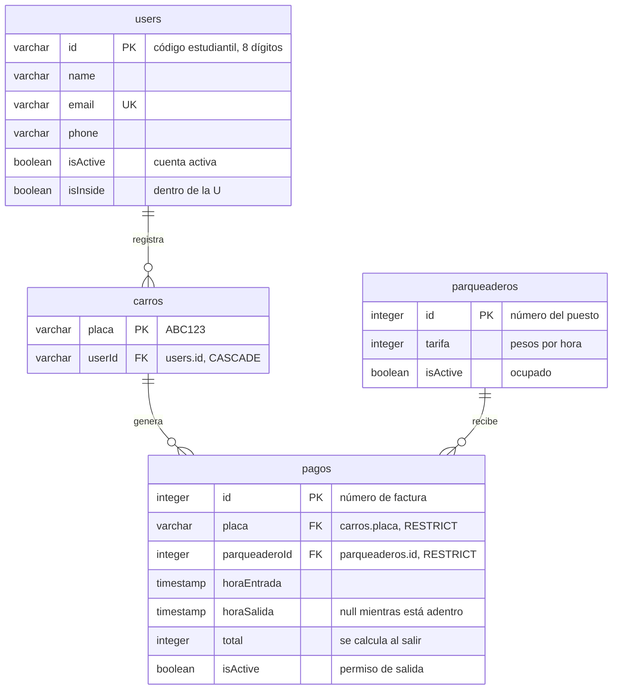

# Jave Parking — Backend

API del parqueadero de la **Pontificia Universidad Javeriana Cali**. Sirve para ahorrar filas al entrar y al pagar: el estudiante registra su carro, ve qué puestos están libres antes de llegar y, al salir, la app calcula cuánto debe pagar según los minutos que estuvo parqueado.

Proyecto del curso **Plataformas Computacionales** (2026-2), construido sobre el seed NestJS del curso.

**Integrantes:**
- Mateo Rivera Prados
- Diego Alejandro Calvo 
- Jan Pieter Lelie
- Carlos Sánchez

## Qué hace la API

| Módulo | Para qué sirve |
|---|---|
| **Users** | Estudiantes registrados con su código estudiantil. |
| **Carros** | Placas que registra cada estudiante (formato `ABC123`). |
| **Parqueaderos** | Puestos del parqueadero, con su tarifa por hora y si están ocupados. |
| **Pagos** | Facturas: entrada de un carro a un puesto, salida y cobro por minuto. |

## Tecnologías

- **NestJS 11** + TypeScript
- **TypeORM** con **SQLite** (por defecto) o **Postgres**
- **class-validator** / **class-transformer** para validar los datos
- **Postman** para probar
- **AWS EC2** (Amazon Linux 2023) + **PM2** para el despliegue

## Modelo de datos

- **`pagos` es la tabla intermedia** entre carros y parqueaderos: un carro usa muchos puestos y un puesto recibe muchos carros. No es un `@ManyToMany` directo porque cada visita guarda sus propios datos (horas y
